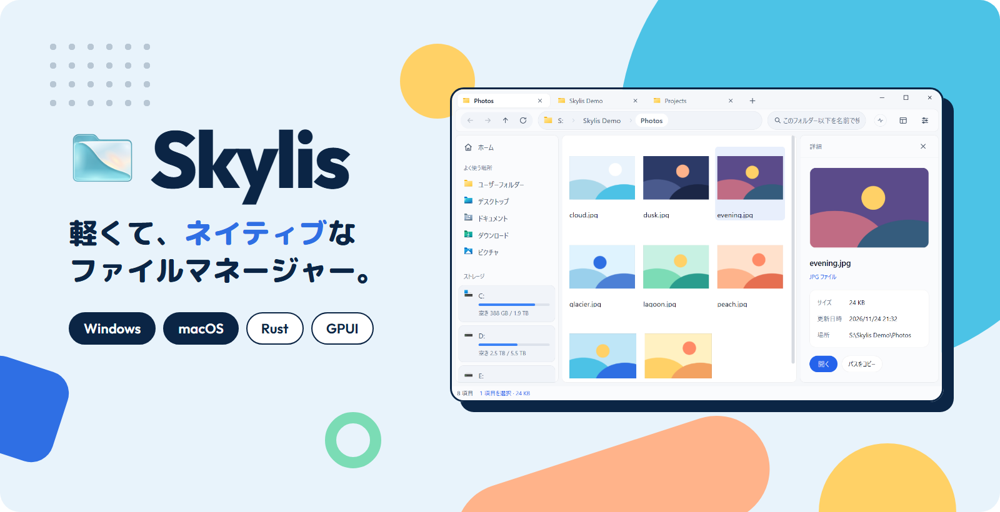
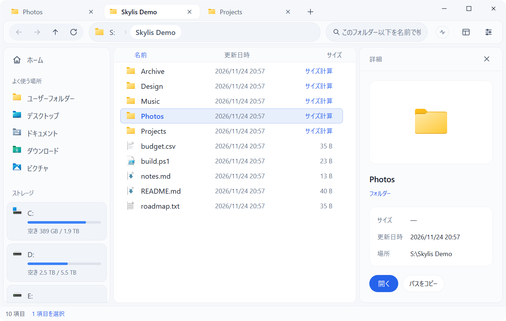
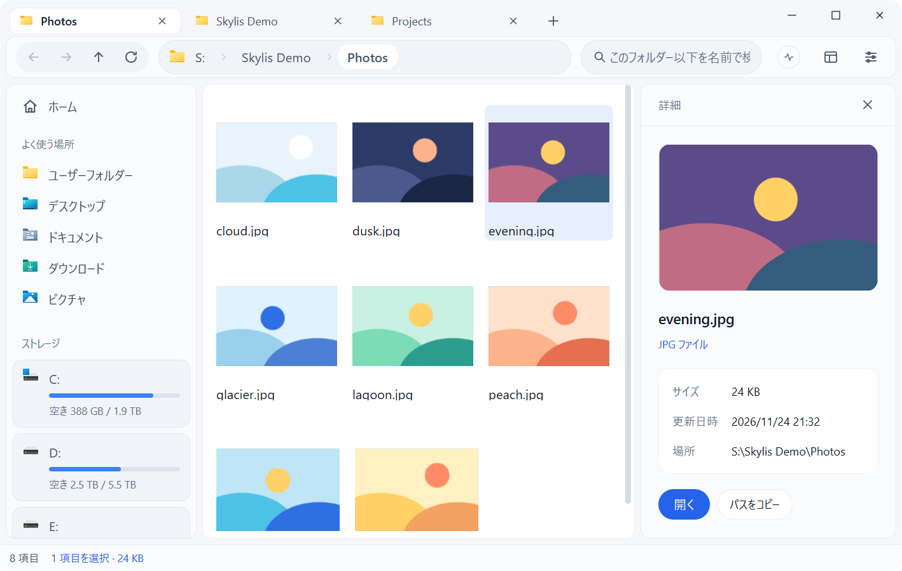
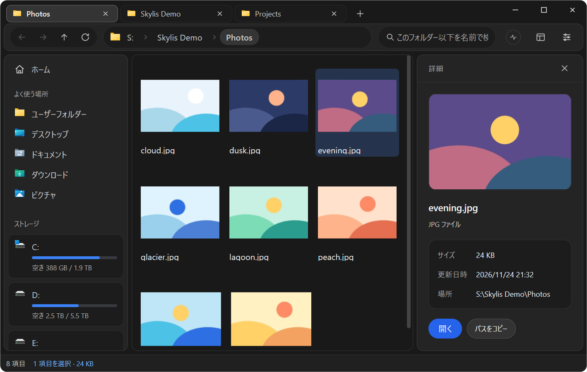

<div align="center">

<p><a href="README.md">English</a> · <b>日本語</b></p>



<p>
  <strong>軽く、すばやく、気持ちよく。</strong><br>
  Rust と GPU 描画でつくった、Windows / macOS 向けのネイティブ ファイルマネージャー。
</p>

<p>
  <a href="https://github.com/riku1227/Skylis-File-Manager/actions/workflows/ci.yml"></a>
  <a href="LICENSE"></a>
  
  
</p>

<p>
  <a href="#-特長">特長</a> ·
  <a href="#-スクリーンショット">スクリーンショット</a> ·
  <a href="#-はじめる">はじめる</a> ·
  <a href="#️-キーボードショートカット">ショートカット</a> ·
  <a href="README_DEV.ja.md">開発者向け</a>
</p>

</div>

## ✨ 特長

<table>
<tr>
<td width="50%" valign="top">

### ⚡ 軽量・ネイティブ
WebView を使わず、[GPUI](https://crates.io/crates/gpui-fast) で GPU 描画。アイコン取得・サムネイル・サイズ計算はすべてバックグラウンドで行うので、大きなフォルダーでも UI が止まりません。

</td>
<td width="50%" valign="top">

### 🗂️ タブとウィンドウ
タブの追加・複製・並べ替え、閉じたタブの復元。タブをドラッグして別ウィンドウに切り離したり統合したり。前回のタブ構成は次回起動時に復元されます。

</td>
</tr>
<tr>
<td valign="top">

### 🖼️ ギャラリーとプレビュー
画像の多いフォルダーは自動でタイル表示に。<kbd>Space</kbd> で別窓クイックプレビュー、詳細ペインでサムネイルとメタ情報を確認できます。

</td>
<td valign="top">

### 📦 ZIP / 7z をそのまま開く
圧縮ファイルはダブルクリックで仮想フォルダーとして閲覧。全体または選んだ項目だけを解凍でき、選択したファイルから ZIP / 7z も作成できます。

</td>
</tr>
<tr>
<td valign="top">

### 🔎 すばやい移動と検索
パンくずをクリックしてパスを直接入力、名前の先頭へタイプでジャンプ、<kbd>Ctrl</kbd>+<kbd>F</kbd> で名前検索。ホーム画面にはドライブ容量と主要フォルダー、ピン留めした場所が並びます。

</td>
<td valign="top">

### 🪟 OS とのなじみ
Windows のコピー／移動エンジンとごみ箱、Shell の右クリックメニュー、OS のファイルアイコンをそのまま利用。外部変更は自動で一覧に反映されます。

</td>
</tr>
<tr>
<td valign="top">

### 🌗 ライト／ダーク
OS 設定に追従するテーマと、<kbd>Ctrl</kbd>+<kbd>Shift</kbd>+<kbd>L</kbd> での切り替え。高リフレッシュレートのディスプレイでもなめらかなアニメーション。

</td>
<td valign="top">

### 🔁 エクスプローラーの代わりに
設定の「Windows 連携」で、フォルダーを開く操作や <kbd>Win</kbd>+<kbd>E</kbd> を Skylis で開くよう切り替えられます。いつでも元に戻せます。

</td>
</tr>
</table>

## 📸 スクリーンショット

<picture>
  <source media="(prefers-color-scheme: dark)" srcset="docs/assets/readme/list-dark.png">
  
</picture>

<p align="center"><sub>タブ・パンくず・詳細ペインを備えたファイル一覧（GitHub のテーマに合わせてライト／ダークが切り替わります）</sub></p>

<table>
<tr>
<td width="50%"></td>
<td width="50%"></td>
</tr>
<tr>
<td align="center"><sub>ギャラリー表示と詳細ペイン（ライト）</sub></td>
<td align="center"><sub>同じ画面のダークテーマ</sub></td>
</tr>
</table>

## 🚀 はじめる

> [!NOTE]
> Skylis は現在開発中（v0.1）です。ビルド済みバイナリの配布は準備中のため、今はソースからビルドして利用できます。

### 必要な環境

| OS | 状況 |
| --- | --- |
| Windows 10 / 11（x64） | メインの対応環境 |
| macOS（Apple Silicon） | ローカルビルドの `.app` で動作。公証済みの配布物はまだありません |

### Windows でのインストールとアンインストール

`Skylis-<version>-x64-setup.exe` を実行すると、管理者権限なしで現在の Windows ユーザーにインストールできます。既定の場所は `%LOCALAPPDATA%\Programs\Skylis` です。スタートメニューにショートカットが追加され、デスクトップへの追加も選べます。インストーラーをソースから作成する手順は [README_DEV.ja.md](README_DEV.ja.md#windows-インストーラーのビルド) を参照してください。

アンインストールするには、Skylis を閉じて、Windows の **［設定］→［アプリ］→［インストールされているアプリ］**（Windows 10 では **［アプリと機能］**）から削除します。アンインストーラーは、アプリを削除する前に Windows のフォルダー連携の復元を試みます。`%APPDATA%\Skylis\settings.conf` などのユーザー設定はそのまま残ります。

### ソースからビルド（Windows）

[Rust](https://www.rust-lang.org/tools/install) と Visual Studio の「C++ によるデスクトップ開発」を用意して、次を実行します。

```powershell
git clone https://github.com/riku1227/Skylis-File-Manager.git
cd Skylis-File-Manager
cargo build --release --locked -p explorer
.\target\release\skylis.exe
```

macOS の手順や詳しい環境構築は [README_DEV.ja.md](README_DEV.ja.md) を参照してください。

### 起動オプション

```powershell
skylis.exe                              # ホーム画面で起動
skylis.exe "D:\Photos"                  # フォルダーを開く
skylis.exe --select "D:\Photos\a.jpg"   # 親フォルダーを開いて項目を選択
skylis.exe --theme dark                 # light / dark / system
```

## ⌨️ キーボードショートカット

macOS では、タブ・検索・パス入力・コピー＆ペーストなどの主な操作に <kbd>Cmd</kbd> を使えます。

<details open>
<summary><b>タブとナビゲーション</b></summary>

| 操作 | キー |
| --- | --- |
| 新しいタブ／タブを閉じる | <kbd>Ctrl</kbd>+<kbd>T</kbd> / <kbd>Ctrl</kbd>+<kbd>W</kbd> |
| 新しいウィンドウ | <kbd>Ctrl</kbd>+<kbd>N</kbd> |
| タブの切り替え | <kbd>Ctrl</kbd>+<kbd>Tab</kbd> / <kbd>Ctrl</kbd>+<kbd>Shift</kbd>+<kbd>Tab</kbd> |
| 閉じたタブを復元 | <kbd>Ctrl</kbd>+<kbd>Shift</kbd>+<kbd>T</kbd> |
| タブを複製 | <kbd>Ctrl</kbd>+<kbd>Shift</kbd>+<kbd>K</kbd> |
| 戻る／進む／親フォルダーへ | <kbd>Alt</kbd>+<kbd>←</kbd>（<kbd>Backspace</kbd>） / <kbd>Alt</kbd>+<kbd>→</kbd> / <kbd>Alt</kbd>+<kbd>↑</kbd> |
| パスを直接入力 | <kbd>Ctrl</kbd>+<kbd>L</kbd> / <kbd>Alt</kbd>+<kbd>D</kbd> |
| 名前で検索 | <kbd>Ctrl</kbd>+<kbd>F</kbd>（<kbd>Esc</kbd> で解除） |
| 再読み込み | <kbd>F5</kbd> / <kbd>Ctrl</kbd>+<kbd>R</kbd> |

</details>

<details>
<summary><b>ファイル操作</b></summary>

| 操作 | キー |
| --- | --- |
| 開く | <kbd>Enter</kbd> / ダブルクリック |
| クイックプレビュー | <kbd>Space</kbd> |
| コピー／切り取り／貼り付け | <kbd>Ctrl</kbd>+<kbd>C</kbd> / <kbd>Ctrl</kbd>+<kbd>X</kbd> / <kbd>Ctrl</kbd>+<kbd>V</kbd> |
| すべて選択 | <kbd>Ctrl</kbd>+<kbd>A</kbd> |
| パスをコピー | <kbd>Ctrl</kbd>+<kbd>Shift</kbd>+<kbd>C</kbd> |
| 名前の変更 | <kbd>F2</kbd> |
| 新しいフォルダー | <kbd>Ctrl</kbd>+<kbd>Shift</kbd>+<kbd>N</kbd> |
| ごみ箱へ移動／完全に削除 | <kbd>Delete</kbd> / <kbd>Shift</kbd>+<kbd>Delete</kbd> |
| プロパティ（Windows） | <kbd>Alt</kbd>+<kbd>Enter</kbd> |
| 範囲選択 | <kbd>Shift</kbd>+矢印 / <kbd>Home</kbd> / <kbd>End</kbd> / <kbd>PageUp</kbd> / <kbd>PageDown</kbd> |
| 名前の先頭へジャンプ | 一覧で文字を入力 |
| 右クリックメニュー | <kbd>Shift</kbd>+<kbd>F10</kbd> / <kbd>Menu</kbd> |

</details>

<details>
<summary><b>表示</b></summary>

| 操作 | キー |
| --- | --- |
| 隠しファイルの表示切り替え | <kbd>Ctrl</kbd>+<kbd>H</kbd> |
| テーマ切り替え（ライト → ダーク → システム） | <kbd>Ctrl</kbd>+<kbd>Shift</kbd>+<kbd>L</kbd> |
| ファイル操作の進行状況 | <kbd>Ctrl</kbd>+<kbd>Shift</kbd>+<kbd>J</kbd> |
| 設定 | <kbd>Ctrl</kbd>+<kbd>,</kbd> |

</details>

## 🔁 Windows 連携

設定 →「Windows 連携」で、次の3つを個別にオン／オフできます。

- **フォルダーを開く操作** を Skylis で開く
- <kbd>Win</kbd>+<kbd>E</kbd> で Skylis を開く
- エクスプローラーの背景メニューに「**Skylis へ切り替え**」を追加

いずれも設定画面からいつでも元に戻せます。他のアプリが `explorer.exe` を直接起動する場合は対象外です。ソースからビルドした Skylis を直接使っている場合は、実行ファイルを移動・削除する前に `skylis.exe --restore-integration` を実行してください。

## 🐞 不具合の報告

[Issues](https://github.com/riku1227/Skylis-File-Manager/issues) で受け付けています。再現手順と、あればクラッシュログを添えてください。

| OS | クラッシュログの保存先 |
| --- | --- |
| Windows | `%LOCALAPPDATA%\Skylis\logs\` |
| macOS | `~/Library/Logs/Skylis/` |

ファイル名は `crash-YYYYMMDD-HHMMSS-<pid>.log`（UTC）で、直近 20 件を保持します。

## 🛠️ 開発に参加する

ビルド環境の構築、テスト、リポジトリ構成、コミット規約は **[README_DEV.ja.md](README_DEV.ja.md)** にまとめています。

## 📄 ライセンス

[Apache License 2.0](LICENSE)。同梱している第三者ソースの出典とライセンスは [licenses/README.md](licenses/README.md) を参照してください。

<div align="center">
<br>

<br>
<sub>Made with 🦀 Rust and GPUI</sub>
</div>
