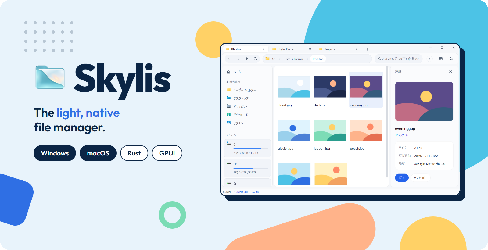
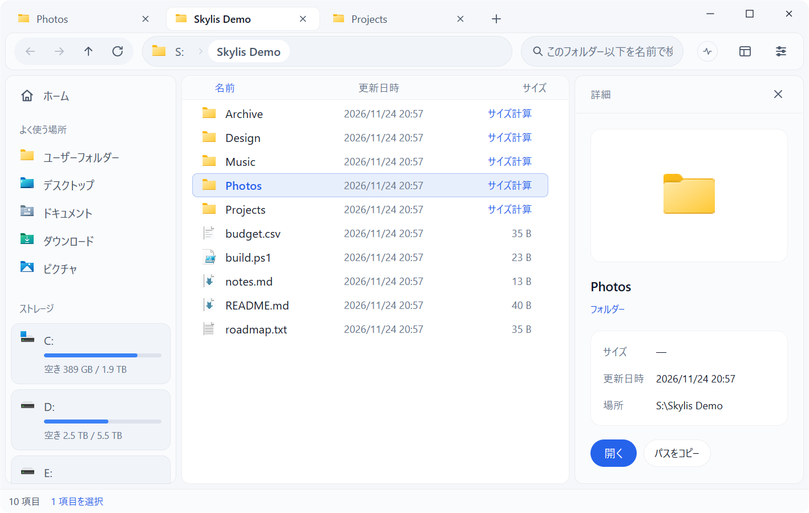
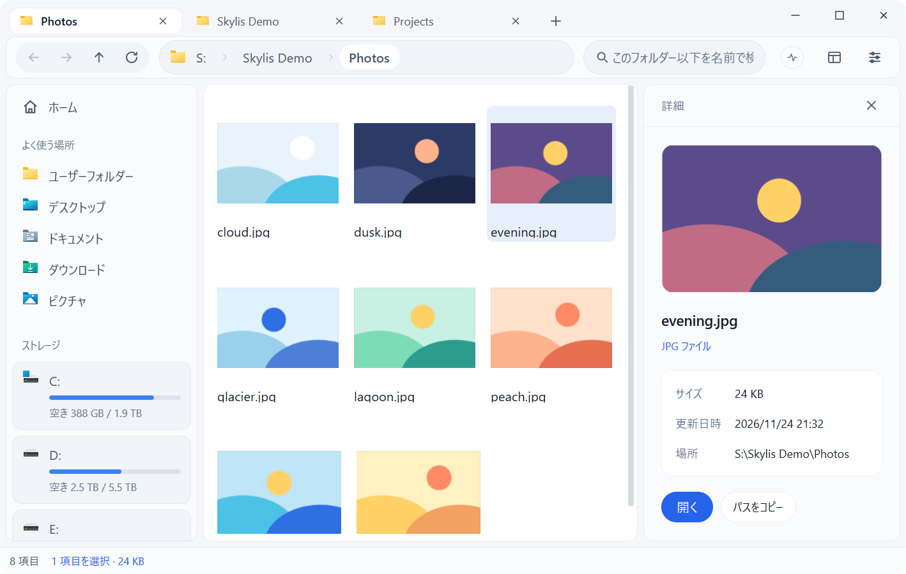
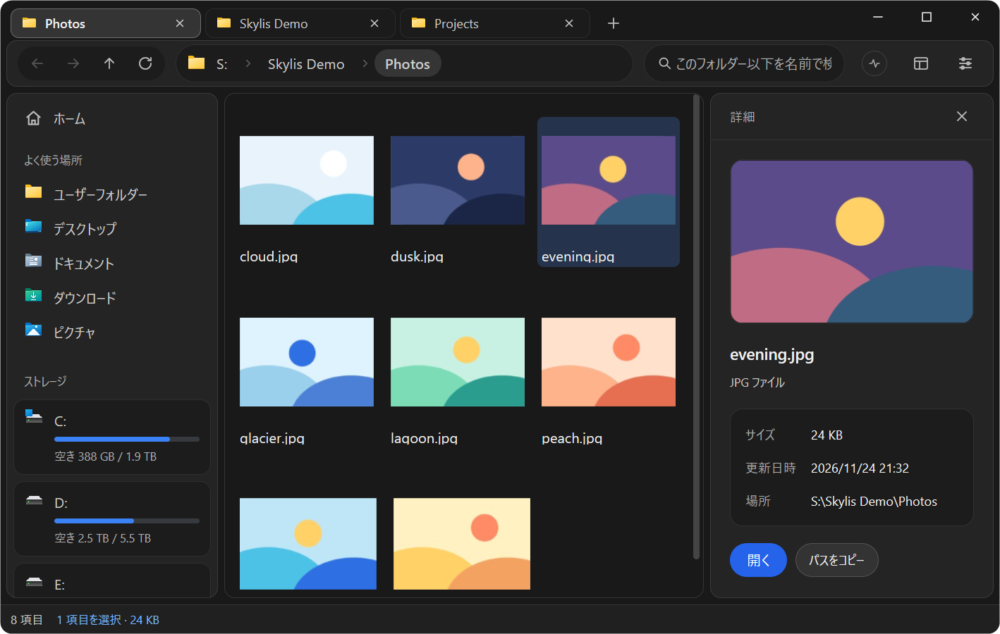

<div align="center">

<p><b>English</b> · <a href="README.ja.md">日本語</a></p>



<p>
  <strong>Light, fast, and pleasant to use.</strong><br>
  A native file manager for Windows and macOS, built with Rust and GPU rendering.
</p>

<p>
  <a href="https://github.com/riku1227/Skylis-File-Manager/actions/workflows/ci.yml"></a>
  <a href="LICENSE"></a>
  
  
</p>

<p>
  <a href="#-features">Features</a> ·
  <a href="#-screenshots">Screenshots</a> ·
  <a href="#-getting-started">Getting started</a> ·
  <a href="#️-keyboard-shortcuts">Shortcuts</a> ·
  <a href="README_DEV.md">For developers</a>
</p>

</div>

> [!NOTE]
> The Skylis user interface is currently available in Japanese only.

## ✨ Features

<table>
<tr>
<td width="50%" valign="top">

### ⚡ Light and native
No WebView: the UI is GPU-rendered with [GPUI](https://crates.io/crates/gpui-fast). Icons, thumbnails and size calculations all run in the background, so the UI never stalls — even in huge folders.

</td>
<td width="50%" valign="top">

### 🗂️ Tabs and windows
Open, duplicate and reorder tabs, and bring back closed ones. Drag a tab out into its own window or merge it back. Your tabs are restored the next time you launch.

</td>
</tr>
<tr>
<td valign="top">

### 🖼️ Gallery and preview
Image-heavy folders switch to a tile gallery automatically. Press <kbd>Space</kbd> for a quick-look window, and check thumbnails and metadata in the details pane.

</td>
<td valign="top">

### 📦 Open ZIP / 7z directly
Double-click an archive to browse it like a folder. Extract everything or just the items you pick, and create ZIP / 7z archives from a selection.

</td>
</tr>
<tr>
<td valign="top">

### 🔎 Quick navigation and search
Click the breadcrumb to type a path, type in the list to jump to a name, or press <kbd>Ctrl</kbd>+<kbd>F</kbd> to filter by name. The Home screen shows drive usage, common folders and your pinned places.

</td>
<td valign="top">

### 🪟 At home in your OS
Uses the Windows copy/move engine and Recycle Bin, the Shell context menu and native file icons. External changes show up in the list automatically.

</td>
</tr>
<tr>
<td valign="top">

### 🌗 Light and dark
Follows your OS theme, or cycle it with <kbd>Ctrl</kbd>+<kbd>Shift</kbd>+<kbd>L</kbd>. Animations stay smooth on high-refresh-rate displays.

</td>
<td valign="top">

### 🔁 Replace File Explorer
Under “Windows integration” in Settings, make folder opening and <kbd>Win</kbd>+<kbd>E</kbd> launch Skylis. You can switch back at any time.

</td>
</tr>
</table>

## 📸 Screenshots

<picture>
  <source media="(prefers-color-scheme: dark)" srcset="docs/assets/readme/list-dark.png">
  
</picture>

<p align="center"><sub>File list with tabs, breadcrumbs and the details pane (switches between light and dark with your GitHub theme)</sub></p>

<table>
<tr>
<td width="50%"></td>
<td width="50%"></td>
</tr>
<tr>
<td align="center"><sub>Gallery view and details pane (light)</sub></td>
<td align="center"><sub>The same view in the dark theme</sub></td>
</tr>
</table>

## 🚀 Getting started

> [!NOTE]
> Skylis is in early development (v0.1). Prebuilt binaries are not available yet, so for now you need to build it from source.

### Supported platforms

| OS | Status |
| --- | --- |
| Windows 10 / 11 (x64) | Primary platform |
| macOS (Apple Silicon) | Runs as a locally built `.app`; no notarized release yet |

### Install and uninstall on Windows

Run `Skylis-<version>-x64-setup.exe` to install Skylis for your Windows account without administrator privileges. The default location is `%LOCALAPPDATA%\Programs\Skylis`. Setup adds a Start Menu shortcut and offers an optional desktop shortcut. To build the installer from source, see [README_DEV.md](README_DEV.md#build-the-windows-installer).

To uninstall, close Skylis and remove it from **Settings → Apps → Installed apps** (or **Apps & features** on Windows 10). The uninstaller attempts to restore Windows folder integration before removing the app. Your settings, including `%APPDATA%\Skylis\settings.conf`, stay in place.

### Build from source (Windows)

Install [Rust](https://www.rust-lang.org/tools/install) and Visual Studio's “Desktop development with C++” workload, then run:

```powershell
git clone https://github.com/riku1227/Skylis-File-Manager.git
cd Skylis-File-Manager
cargo build --release --locked -p explorer
.\target\release\skylis.exe
```

For macOS and the full development setup, see [README_DEV.md](README_DEV.md).

### Launch options

```powershell
skylis.exe                              # open the Home screen
skylis.exe "D:\Photos"                  # open a folder
skylis.exe --select "D:\Photos\a.jpg"   # open the parent folder and select the item
skylis.exe --theme dark                 # light / dark / system
```

## ⌨️ Keyboard shortcuts

On macOS, <kbd>Cmd</kbd> works for the main actions such as tabs, search, the address bar and copy & paste.

<details open>
<summary><b>Tabs and navigation</b></summary>

| Action | Keys |
| --- | --- |
| New tab / close tab | <kbd>Ctrl</kbd>+<kbd>T</kbd> / <kbd>Ctrl</kbd>+<kbd>W</kbd> |
| New window | <kbd>Ctrl</kbd>+<kbd>N</kbd> |
| Switch tabs | <kbd>Ctrl</kbd>+<kbd>Tab</kbd> / <kbd>Ctrl</kbd>+<kbd>Shift</kbd>+<kbd>Tab</kbd> |
| Reopen closed tab | <kbd>Ctrl</kbd>+<kbd>Shift</kbd>+<kbd>T</kbd> |
| Duplicate tab | <kbd>Ctrl</kbd>+<kbd>Shift</kbd>+<kbd>K</kbd> |
| Back / forward / up | <kbd>Alt</kbd>+<kbd>←</kbd> (<kbd>Backspace</kbd>) / <kbd>Alt</kbd>+<kbd>→</kbd> / <kbd>Alt</kbd>+<kbd>↑</kbd> |
| Type a path | <kbd>Ctrl</kbd>+<kbd>L</kbd> / <kbd>Alt</kbd>+<kbd>D</kbd> |
| Search by name | <kbd>Ctrl</kbd>+<kbd>F</kbd> (<kbd>Esc</kbd> to clear) |
| Refresh | <kbd>F5</kbd> / <kbd>Ctrl</kbd>+<kbd>R</kbd> |

</details>

<details>
<summary><b>File operations</b></summary>

| Action | Keys |
| --- | --- |
| Open | <kbd>Enter</kbd> / double-click |
| Quick preview | <kbd>Space</kbd> |
| Copy / cut / paste | <kbd>Ctrl</kbd>+<kbd>C</kbd> / <kbd>Ctrl</kbd>+<kbd>X</kbd> / <kbd>Ctrl</kbd>+<kbd>V</kbd> |
| Select all | <kbd>Ctrl</kbd>+<kbd>A</kbd> |
| Copy path | <kbd>Ctrl</kbd>+<kbd>Shift</kbd>+<kbd>C</kbd> |
| Rename | <kbd>F2</kbd> |
| New folder | <kbd>Ctrl</kbd>+<kbd>Shift</kbd>+<kbd>N</kbd> |
| Move to Recycle Bin / delete permanently | <kbd>Delete</kbd> / <kbd>Shift</kbd>+<kbd>Delete</kbd> |
| Properties (Windows) | <kbd>Alt</kbd>+<kbd>Enter</kbd> |
| Extend selection | <kbd>Shift</kbd>+arrows / <kbd>Home</kbd> / <kbd>End</kbd> / <kbd>PageUp</kbd> / <kbd>PageDown</kbd> |
| Jump to a name | Start typing in the list |
| Context menu | <kbd>Shift</kbd>+<kbd>F10</kbd> / <kbd>Menu</kbd> |

</details>

<details>
<summary><b>View</b></summary>

| Action | Keys |
| --- | --- |
| Show / hide hidden files | <kbd>Ctrl</kbd>+<kbd>H</kbd> |
| Cycle theme (light → dark → system) | <kbd>Ctrl</kbd>+<kbd>Shift</kbd>+<kbd>L</kbd> |
| File operation progress | <kbd>Ctrl</kbd>+<kbd>Shift</kbd>+<kbd>J</kbd> |
| Settings | <kbd>Ctrl</kbd>+<kbd>,</kbd> |

</details>

## 🔁 Windows integration

In Settings → “Windows integration”, you can turn each of these on or off:

- Open folders in Skylis
- Open Skylis with <kbd>Win</kbd>+<kbd>E</kbd>
- Add “**Switch to Skylis**” to File Explorer's background context menu

Each one can be reverted from Settings at any time. Apps that launch `explorer.exe` directly are not affected. If you run Skylis directly from a source build, run `skylis.exe --restore-integration` before moving or deleting the executable.

## 🐞 Reporting bugs

Please open an [issue](https://github.com/riku1227/Skylis-File-Manager/issues) with steps to reproduce and, if available, a crash log.

| OS | Crash log location |
| --- | --- |
| Windows | `%LOCALAPPDATA%\Skylis\logs\` |
| macOS | `~/Library/Logs/Skylis/` |

Logs are named `crash-YYYYMMDD-HHMMSS-<pid>.log` (UTC), and the 20 most recent are kept.

## 🛠️ Contributing

Setup, building, testing, repository layout and commit conventions are covered in **[README_DEV.md](README_DEV.md)**.

## 📄 License

[Apache License 2.0](LICENSE). For the origin and licenses of bundled third-party sources, see [licenses/README.md](licenses/README.md).

<div align="center">
<br>

<br>
<sub>Made with 🦀 Rust and GPUI</sub>
</div>
