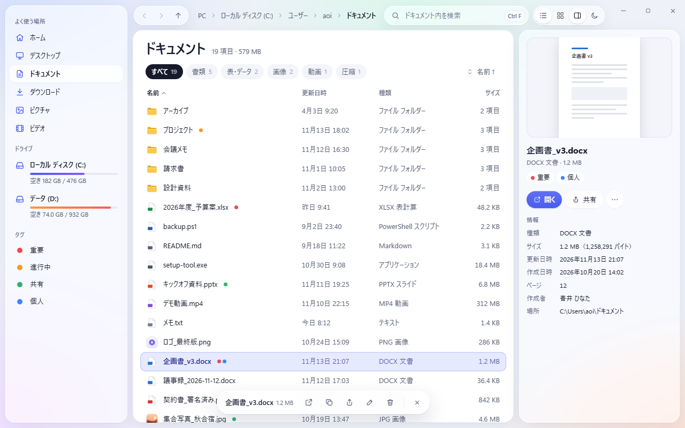
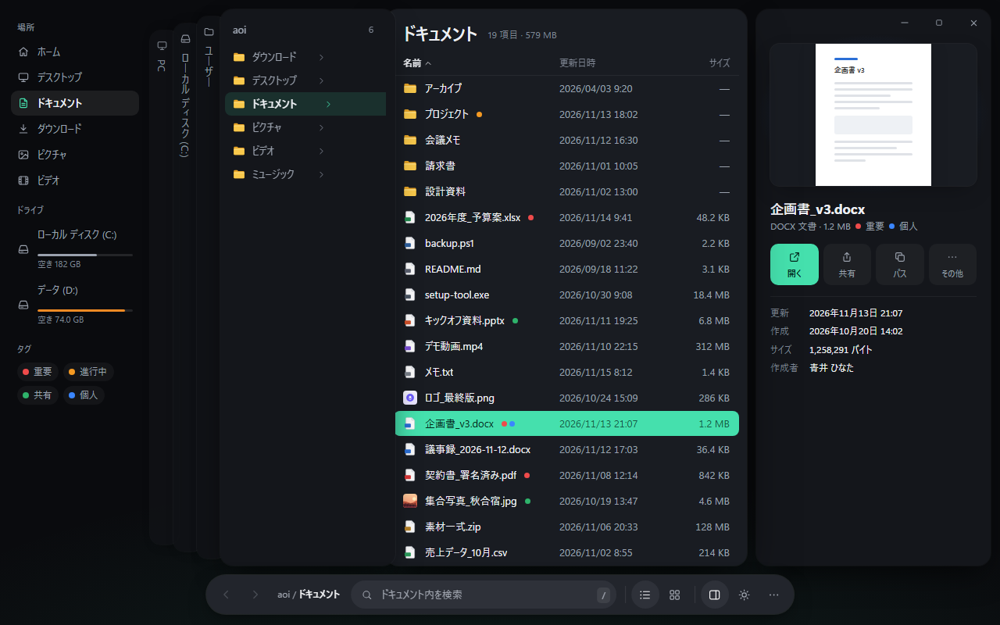
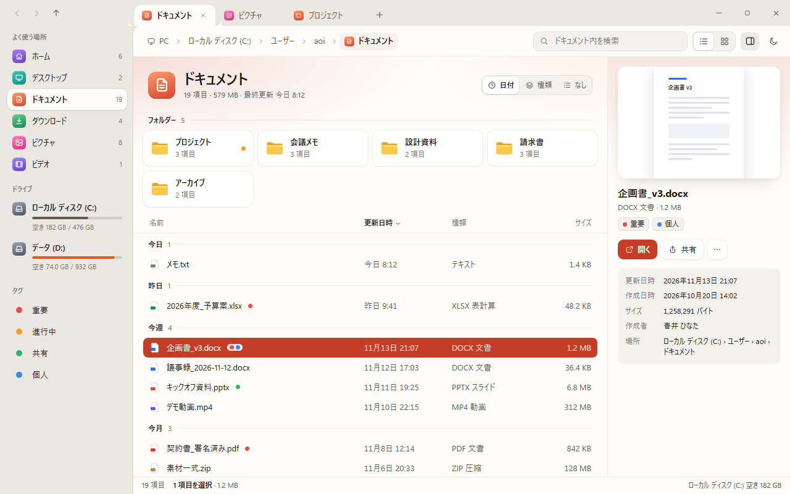

# Explorer 新デザイン 3案（opus）

| 案 | ファイル | 一言 |
|---|---|---|
| 1. **Air** — 浮かぶ面 | [concept-1.html](./concept-1.html) | 明るく軽やか。色づいた地の上に面が浮き、ツールバーは帯ではなくカプセル |
| 2. **Trail** — 重なる階層 | [concept-2.html](./concept-2.html) | 大胆な構造変更。祖先フォルダーを重なった紙と縦書きの背表紙で見せ、操作は下部のコマンド島に集める |
| 3. **Spaces** — 色のある場所 | [concept-3.html](./concept-3.html) | 場所ごとに色を持つ。タブ、フォルダーの棚、日付ごとのまとまり |

スクリーンショット（すべて1280×800。`-1100x700` だけ 1100×700）: [screenshots/](./screenshots/)
`concept-N.png`（基本）/ `-dark` または `-light`（もう一方のテーマ）/ `-grid-pictures`（ピクチャをアイコン表示）/ `-macos`（macOS配置＋仮の青フォルダー）/ `-1100x700`

各HTMLは単一ファイルで、CSS・JS・SVGをすべて埋め込んでいる。ネットワークもビルドも要らない。
右下の小さな「?」ボタン（または `?` キー）で**レビュー用パネル**が開き、テーマ・OS配置・仮フォルダー色を切り替えられる。説明はこのパネルとこのメモにだけ書き、本体の画面には置いていない。
URLハッシュでも初期状態を指定できる（例: `concept-2.html#theme=light&path=pics&view=grid&sel=夕焼けの海.jpg&os=mac&icons=mac`）。

---

## 0. 前回の評価をどう読んだか

評価は「macってあまりグレーを使ってるイメージがない」「パッとしない」「一個前のトレンドのシステムUI」だった。前回（concept-macos.html）は配色を無彩色に寄せ、選択色を濃い青に変えただけで、骨格はWindows 10〜11初期の作りのままだった。具体的には次の5点。

1. **ウィンドウ全体が1枚の平面**: クローム・一覧・詳細が端まで接した長方形で、1px線と明るさの差だけで区切られている。2020年前後のシステムUIの文法。
2. **全部が同じ大きさ・同じ重さの文字**: 13pxの行が並ぶだけで、見出しがない。今どこにいるかがパンくずの小さい文字にしかない。
3. **灰色の役割が大きすぎる**: 面・ボタン・入力欄・非選択状態がすべて灰色の濃淡なので、画面の大半が無彩色になる。
4. **奥行きがない**: 浮いている物（ツールバーの操作群・詳細）と下地の区別がない。最近のmacOS/iPadOSやWindows 11の新しいアプリは、浮く物（カプセル・カード・ガラス）と下地をはっきり分けている。
5. **操作の置き場所が固定的**: 上の帯にすべてを並べている。選択したときの操作も、検索の位置も昔のまま。

なので今回は、配色ではなく**面の構成・見出しの階層・浮く物と下地の関係・操作の置き場所**を変えた。色は「灰色をやめる」だけで終わらせず、案ごとに色の持たせ方そのものを変えている（1: 地に淡いグラデーション、2: 一点だけ鮮やかなアクセント、3: 場所ごとの色）。

## 1. 3案に共通する前提

- **主役はファイル**。3案とも一覧が画面の最大面積で、詳細リスト（名前・更新日時・種類・サイズ、列見出しクリックで並べ替え）を必ず持つ。アイコン（グリッド）表示もある。
- **同じ架空データ**（`ドキュメント` 19項目＋サブフォルダー、`ピクチャ`、`ダウンロード` など）を3案で使い、比較しやすくした。タグ（重要・進行中・共有・個人）は3案とも色の点で表す。
- **ファイル・フォルダー・ドライブのカラーアイコンと写真サムネイルはすべて仮素材**。実在するOSのアイコンは取得していない。実装ではOSのシェルアイコン／サムネイルに置き換わる前提。仮フォルダーはWindows風（黄）とmacOS風（青）を切り替えられ、どちらの色でも成立するか確認できる。
- **操作アイコン**は24pxグリッド・線幅1.7・丸端・`currentColor` で統一した自作の線画SVG。外部のアイコンセットのコードは含まない。
- **OS配置**: タイトルバーは自前で描く前提。Windowsでは右上にキャプションボタン（最小化・最大化・閉じる）、macOSでは左上に信号ボタンを置く。違いは配置だけで、外観は共通にした。丸い信号ボタンを付けただけの「mac風」にはしていない。
- **実装した操作（3案共通）**: 行のクリック選択、Ctrl+クリックで追加、Shift+クリックで範囲選択、↑↓（グリッドでは←→も）、Home/End、Ctrl+A、Esc、Enter・ダブルクリックでフォルダーを開く、Backspace・Alt+←で戻る、Alt+→で進む、Alt+↑で上へ、Ctrl+F・`/` で検索（入力するたびに絞り込み、一致部分をハイライト）、リスト/アイコン表示の切替、詳細パネルの開閉、ライト/ダークの切替。
- フォント: Segoe UI Variable → Segoe UI → Yu Gothic UI（mac: Hiragino Sans）。日付とサイズは `tabular-nums`。

---

## 2. 案1 Air — 浮かぶ面



### 狙い
「明るく軽やか」の担当。ウィンドウの地を**淡い色のグラデーション**（青・桃・ミント・薄紫を四隅にぼかしたもの）にし、その上にサイドバー・一覧・詳細を角丸18pxの**浮いた面**として置いた。灰色の帯はどこにもない。

### 構成
```
┌──────────┐ (‹ › ↑)  PC › C: › … › ドキュメント     (🔍 ドキュメント内を検索  Ctrl F) (≡ ▦ ▯ ☾)  — □ ×
│ ガラスの  │ ┌──────────────────────────────────┐ ┌──────────┐
│ サイドバー │ │ ドキュメント  19 項目 · 579 MB       │ │ ガラスの  │
│ 場所       │ │ (すべて19)(書類5)(表2)(画像2)…  名前↑│ │ 詳細      │
│ ドライブ   │ │ 名前            更新日時  種類  サイズ│ │ プレビュー │
│ タグ ●●●● │ │ ▢ 企画書_v3.docx ●●  …        1.2 MB│ │ [開く][共有]│
│           │ │        ( 企画書_v3.docx 1.2MB ⤴ ⧉ ⇪ ✎ 🗑 × ) │ │ 情報      │
└──────────┘ └──────────────────────────────────┘ └──────────┘
```
- ツールバーは帯ではなく、地の上に浮く**ガラス調のカプセル**（戻る/進む/上へ、表示切替、検索）。
- フォルダー名を**26pxの見出し**にし、件数と合計サイズを添えた。パンくずは上に小さく置く。
- 見出しの下に**種類チップ**（すべて・書類・表・画像・動画・圧縮、件数つき）を置き、1クリックで絞り込める。
- 選択すると一覧の下に**浮かぶ選択バー**が出る（開く・コピー・共有・名前の変更・削除・解除）。操作を手元に寄せるため。
- サイドバーの現在地は「ガラスの上の白いカプセル」で示す。サイドバーのタグを押すと、そのタグで絞り込む。
- 何も選ばれていないとき、詳細パネルには今いるフォルダーの情報と最近の変更が出る。

### 他案との違い
3案の中で最も柔らかく明るい。骨格（左に場所、中央に一覧、右に詳細）はおなじみのままにし、新しさは**面の浮かせ方・見出し・カプセル・選択バー**で出している。慣れた配置のまま「今風」にしたい場合の案。

### トークン（抜粋。正本は concept-1.html の `:root`）
| トークン | ライト | ダーク | 用途 |
|---|---|---|---|
| `base` + `wash-a/b/c/d` | `#eef1f8` + `#cfdcff` `#ffd9c8` `#dcf7ec` `#efe1ff` | `#0d0f17` + `#1e2a63` `#3b1a38` `#0f3029` `#2a1a4a` | 地と四隅のぼかし |
| `glass` / `glass-strong` | 白 58% / 78% | `#222534` 58% / `#2c2f42` 82% | サイドバー・詳細・カプセル |
| `glass-edge` | 白 90%（内側1px） | 白 8% | ガラスの縁 |
| `sheet` | `#ffffff` | `#161823` | 一覧の面（不透明） |
| `text` / `text-2` / `text-3` | `#161a2b` / `#5a6075` / `#6e738d` | `#eceefa` / `#a3a8c0` / `#848aa8` | 3段の文字 |
| `accent` → `accent-2` | `#4a5cf0` → `#8a5cf6` | `#8794ff` → `#b493ff` | 主ボタン・メーター・場所アイコン |
| `sel` / `sel-ring` / `sel-text` | `#e6eaff` / accent 30% / `#1b2580` | accent 22% / 42% / `#ffffff` | 選択（淡い塗り＋輪郭＋太字） |
| `r-card` / `r-row` / `r-pill` | 18 / 10 / 999px | | 面・行・カプセル |
| 行の高さ | 36px（リスト）、タイル118px以上 | | |
| 見出し | 26px / 700（≤1180px幅で23px） | | |
| 幅 | サイドバー228 / 詳細300（≤1180pxで200 / 262） | | |

### GPUIでの注意
- **背景のぼかし（ガラス）**: モックはブラウザの `backdrop-filter`。GPUIで後ろの描画をぼかすには追加の描画パスが要り、標準では用意されていない。**代替**: ガラスは「半透明の塗り（`glass-strong` 相当の不透明度を上げた色）＋内側1pxの明るい縁＋影1段」で表す。地が静止したグラデーションなので、ぼかしがなくても見た目の差は小さい（ガラスの下を動く物はない）。
- **地の放射グラデーション**: GPUIは線形グラデーションは描けるが、放射グラデーションは描けない前提で考える。**代替**: (a) 4つの淡い色を事前に描いた小さな画像をウィンドウ背景に引き伸ばす（ライト/ダークで2枚）、(b) 線形グラデーションを2枚重ねて近づける、(c) 単色の `base` で妥協する。どれでも可読性は変わらない。
- **ウィンドウ自体の透過（Mica／vibrancy）には依存しない**。使うなら追加の選択肢とし、OSの設定やGPU負荷で無効になっても破綻しない色を既定にする。
- 浮かぶ選択バーと検索のフォーカス時の外側の輪は、角丸の塗りと影だけで描ける。
- 列の出し入れはモックではコンテナクエリ（一覧の幅が620px以下で「種類」、420px以下で「更新日時」を隠す）。GPUIでは一覧の測った幅から決める。
- **性能で確かめること**: 角丸＋影つきの面3枚が全面にある状態で、ウィンドウのリサイズ中もフレームが落ちないか。半透明の面を重ねたときの描画コスト。

---

## 3. 案2 Trail — 重なる階層（大胆な構造変更）



### 狙い
「大胆な構造変更」の担当。**サイドバーの帯・上のツールバーの帯・パンくずをなくした**。今いるフォルダーの祖先を**重なった紙**として左に積み、遠い祖先は**縦書きの背表紙**に畳む。どこにいるかを文字列ではなく「紙の重なり」で見せる。

### 構成
```
 場所        ┃PC┃C:┃ユーザー┃┌ aoi ──────┐┌ ドキュメント 19 項目 ─────────┐ ┌ プレビュー ─ — □ ×┐
 ホーム      ┃  ┃  ┃        ┃│ ダウンロード›││ 名前▲          更新日時    サイズ│ │  [大きいプレビュー] │
 ドキュメント ┃縦┃縦┃縦書き  ┃│▶ドキュメント›││ ▢ 企画書_v3.docx  …    1.2 MB │ │ 企画書_v3.docx    │
 …           ┃書┃書┃        ┃│ ピクチャ  › ││ （ミント色の塗りで選択）      │ │ [開く][共有][パス]…│
 ドライブ    ┃き┃き┃        ┃└───────────┘└─────────────────────────────┘ └──────────────────┘
 タグ                    ( ‹ ›  aoi / ドキュメント  [🔍 ドキュメント内を検索  /]  ≡ ▦  ▯ ☀ ⋯ )  ← コマンド島
```
- 左端の「場所」は帯ではなく、地の上に直接置いたリスト。
- その右に**背表紙**（PC → C: → ユーザー）、**親フォルダーの紙**（aoi。今のフォルダーの行が緑みで強調され、手前の紙へつながる）、そして**手前の紙**（今のフォルダー＝詳細リスト）が重なる。遠い祖先ほど小さく奥に下がる。
- 背表紙・親の紙の行を押すと、その階層へ移る。リスト表示では **←で上の階層、→でフォルダーに入る**（列表示に近い操作）。
- 戻る/進む・検索・表示切替・プレビュー開閉・テーマは下部中央の**コマンド島**に集めた。島はライトでも暗い色にして、ファイルの面と操作の面をはっきり分ける。
- 選択は**ミント色の塗り**（ダーク: `#45e0ad` に濃い緑の文字、ライト: `#0b7f60` に白文字）。連続した選択は角丸をつないで1つの塊にする。
- 狭い幅（≤1180px、または詳細を開いていて≤1240px）では親の紙も背表紙に畳み、一覧の幅を確保する。
- 既定はダーク。ライトは暖かい石色の地（`#e9e7e2`）に白い紙。

### 他案との違い
3案の中で唯一、**3ペインの骨格を捨てている**。パンくずも上の帯もない。階層を行き来する作業（深い場所の整理、似たフォルダー間の移動）がいちばん速くなるかわりに、横幅を祖先の表示に使うので、1280px幅でも一覧の「種類」列は隠れる（サイズと更新日時は残る）。

### トークン（抜粋）
| トークン | ライト | ダーク | 用途 |
|---|---|---|---|
| `canvas` | `#e9e7e2` | `#0a0b0e` | 地 |
| `card` / `front` / `spine` | `#f6f5f1` / `#ffffff` / `#efede8` | `#14161b` / `#191c22` / `#101216` | 親の紙 / 手前の紙 / 背表紙 |
| `text` / `text-2` / `text-3` | `#16171b` / `#5d616a` / `#72767f` | `#eef0f4` / `#9aa1ad` / `#7f8693` | |
| `accent` = `sel` | `#0b7f60` | `#45e0ad` | 選択・主ボタン・現在地 |
| `sel-text` | `#ffffff` | `#03241a` | 選択の上の文字 |
| `trail` | accent 12% | accent 13% | 親の紙で「今ここ」の行 |
| `island` / `island-2` | `#17181c` / `#24262c` | `#22252c` / `#2e3139` | コマンド島とその中の入力欄 |
| `shadow-front` | 1px縁＋0 28 60 −16 黒28% | 縁＋黒85% | 手前の紙だけ一段深い影 |
| 寸法 | 場所188 / 親の紙224 / 背表紙38（8px重ねる）/ プレビュー300 / 島の高さ50 / 行32 | | ≤1180pxで場所168・プレビュー264 |

### GPUIでの注意
- **縦書き（背表紙）**: GPUIのテキストには `writing-mode` も文字の回転もない前提。**代替**: (a) 1文字ずつ縦に並べる（日本語は自然に読める。英数字は回転せず縦に積むか、略記にする）、(b) 背表紙はアイコン＋先頭1〜2文字だけにしてツールチップで全文を出す、(c) 文字を画像にして回転描画する（コストが高いので非推奨）。最初は (a)＋(b) を推奨。
- **紙の重なり**: 負の余白と重なり順で描いている。GPUIでは絶対配置か、`z_index` 相当の描画順で再現する。影は手前の紙だけ深くし、背表紙は内側の縁＋浅い影1段に抑える（影の数を増やさない）。
- **コマンド島**: 絶対配置の角丸の塗りと影だけで、ぼかしは使っていない。一覧が島の下を通るので、一覧の下に島の高さぶんの余白を確保する（モックでは紙の下端を島の上で止めた）。
- 連続選択の角丸をつなぐ処理はCSSの `:has()` に頼っている。GPUIでは行を描くときに前後の行の選択状態を見て角丸を決める。
- ←/→による階層移動は、テキスト入力にフォーカスがあるときは無効にする（モックでもそうしている）。
- **性能で確かめること**: 階層を移るたびに親の紙・背表紙・手前の紙を作り直すコスト（モックは全部描き直している。実装では手前の紙の一覧だけ仮想化し、親の紙はキャッシュする）。深い階層（10段以上）で背表紙が増えたとき、背表紙の最大数を決めて、それ以上は「…」の背表紙1本にまとめる必要がある（モックは未対応）。

---

## 4. 案3 Spaces — 色のある場所



### 狙い
**場所に色を持たせる**。ドキュメント=朱、ピクチャ=ローズ、ダウンロード=緑、デスクトップ=青緑、ホーム=紫、ビデオ=菫。今いる場所の色で、選択の塗り・見出しの淡い色かぶり・主ボタン・タブの印・検索のフォーカスが切り替わる。サブフォルダーは、いちばん近い「場所」の色を受け継ぐ。灰色の代わりに**暖かい紙色**（`#fffdfa`／枠 `#ebe7e1`）を使う。

### 構成
```
 ‹ › ↑        ╭ ■ドキュメント × ╮ ■ピクチャ  ■プロジェクト  +                  — □ ×
┌──────────┐ ┌──────────────────────────────────────────────┬───────────┐
│ ■ ホーム 6│ │ ▢PC › C: › ユーザー › aoi › [■ドキュメント]  (🔍     ) ≡▦ ▯ ☾│           │
│ ■ デスクトップ│ │ ▇ ドキュメント           (日付|種類|なし)            │ 詳細       │
│ ■ドキュメント│ │   19 項目 · 579 MB · 最終更新 今日 8:12             │ (場所の色が │
│ ■ ダウンロード│ │ フォルダー 5 ───────────────────               │  上に淡く) │
│ ■ ピクチャ │ │ [📁プロジェクト 3項目●][📁会議メモ][📁設計資料]…    │ プレビュー │
│ ドライブ   │ │ 名前            更新日時▼      種類       サイズ    │ [開く][共有]│
│ タグ       │ │ 今日 1 ─────  メモ.txt …                          │ プロパティ │
│           │ │ 今週 4 ─────  ▇企画書_v3.docx（朱の塗り・白文字）   │           │
└──────────┘ │ 19 項目  1 項目を選択 · 1.2 MB          C: 空き 182 GB │           │
             └──────────────────────────────────────────────┴───────────┘
```
- 上部は**ブラウザ型のタブ**。選ばれているタブは下の面とつながる（角の内側を丸めてつなぐ）。タブの切替・追加・閉じるを実装した。
- 左上（サイドバーの上）に戻る/進む/上へ。サイドバーは枠の色の上に直接置き、場所ごとに**色つきの角丸四角**のアイコンを付けた（中の線画は統一SVGを白で描いたもの）。
- 見出しは44pxの場所アイコン＋24pxのフォルダー名＋件数・合計サイズ・最終更新。見出しのまわりだけ、場所の色をごく淡くかぶせる。
- サブフォルダーは**棚**（カード）として一覧の上にまとめ、ファイルはその下に**まとまり**で並べる。まとまりは 日付（今日・昨日・今週・今月・先月・それ以前）／種類／なし で切り替える。キー移動の順は画面の順（棚 → 各まとまり）。
- 選択は**場所の色の塗り＋白文字**（ダークでは明るい色＋濃い文字）。連続した選択は1つの塊にする。
- 下に細いステータス（件数・選択数と合計・C:の空き）。

### 他案との違い
案1・2が「1つのアクセント色」なのに対し、こちらは**色が場所の意味を持つ**。色でいまの場所が分かり、複数タブを開いても取り違えにくい。骨格は3ペインだが、タブ・棚・まとまりで一覧の読み方そのものを変えている。3案の中でいちばん情報量が多く、常用の作業向き。

### トークン（抜粋）
| トークン | ライト | ダーク | 用途 |
|---|---|---|---|
| `frame` / `surface` / `raise` / `well` | `#ebe7e1` / `#fffdfa` / `#ffffff` / `#f5f2ed` | `#131215` / `#1c1b20` / `#25242a` / `#232228` | 枠・面・カード・くぼみ |
| `text` / `text-2` / `text-3` | `#1d1a17` / `#625b53` / `#7a736b` | `#f2eff4` / `#aaa4ad` / `#8d8792` | |
| `line` | 茶 9% | 白 7% | 罫線 |
| 場所の色（選択の塗り、ライト） | ドキュメント `#c63d27`、ピクチャ `#c42a77`、ダウンロード `#167548`、デスクトップ `#0b7d75`、ホーム `#6f42c1`、ビデオ `#5f3dc4`、その他 `#4c5563` | | 白文字 |
| 場所の色（選択の塗り、ダーク） | `#ff8a6a`、`#ff8cc0`、`#66d996`、`#4fd6c2`、`#b597ff`、`#a891ff`、`#aab3c2` | | 濃い同系色の文字 |
| アイコンの角丸四角 | 明るい色→濃い色の線形グラデーション（例: ドキュメント `#ff9a6b`→`#d4452f`） | | |
| 色かぶり | 場所の色 16%（左上）＋ 明るい色 10%（右上） | | 見出しのまわり220px |
| 寸法 | タブ行42 / ツールバー50 / ステータス28 / サイドバー216 / 詳細296 / 行32 / 棚カード150以上 | | ≤1180pxで192 / 256 |

### GPUIでの注意
- **タブの内側の角丸**（選ばれたタブが下の面につながる部分）は、モックでは放射グラデーションで切り抜いている。GPUIでは小さなSVGパス（角の形）を2つ描くか、タブ本体を1本のパスで描く。
- **色かぶり**は放射グラデーション2枚。GPUIでは場所の色を使った線形グラデーション（上→下、色→透明）1枚で十分近い。場所の数ぶん色を決めておき、`color-mix` は使わずに事前に計算したトークンにする。
- 場所の色は**ライト/ダークで別の値**を持ち、選択の上の文字色も対で持つ（上の表）。コントラストはすべて4.99:1以上。
- まとまりの見出しは一覧の中の「見出し行」として仮想リストに混ぜる。行の高さが2種類になるので、GPUIの `uniform_list` ではなく高さの違う行を扱えるリストが要る（または見出し行も32pxにそろえる）。
- 棚（フォルダーのカード）は折り返すグリッド。フォルダーが多い場所（数百）では棚を1行に制限し「すべて表示」にする必要がある（モックは未対応）。
- **性能で確かめること**: 場所を移るたびに色トークンを差し替えたときの再描画の範囲。まとまりを切り替えたときの並べ替えのコスト（日付まとまりは更新日時で一度並べ替えれば作れる）。

---

## 5. 3案の比較

| | 1 Air | 2 Trail | 3 Spaces |
|---|---|---|---|
| 骨格 | 3ペイン（浮いた面） | 場所＋重なった紙＋プレビュー、上の帯なし | タブ＋3ペイン |
| 現在地の示し方 | 大見出し＋小さなパンくず | 紙の重なりと背表紙 | タブ＋パス（チップ）＋場所の色＋大見出し |
| 操作の置き場所 | 上のカプセル＋浮かぶ選択バー | 下部のコマンド島 | 上のツールバー＋詳細パネル |
| 色の持たせ方 | 地の淡いグラデーション＋青紫のアクセント | 一点だけ鮮やかなミント | 場所ごとの色 |
| 選択 | 淡い塗り＋輪郭＋太字 | 鮮やかな塗り（塊でつなぐ） | 場所の色の塗り（塊でつなぐ） |
| 既定のテーマ | ライト | ダーク | ライト |
| 一覧の読み方 | 種類チップで絞る | 列で潜る（←→で階層移動） | 棚＋まとまり（日付/種類） |
| GPUIでの難所 | 背景のぼかし（代替: 半透明の塗り）、放射グラデーション | 縦書き、重なり順 | タブの角、高さの違う行が混ざる仮想リスト |

## 6. 検証結果

ヘッドレスChrome（DevTools Protocol）で、3案 × ライト/ダーク × 1280×800/1100×700 の12通りを自動で確かめた。

- **操作（19項目、12通りすべて合格）**: クリック選択、Ctrl+クリックで追加、Shift+クリックで範囲、↓キー、Ctrl+A、Escで解除、検索の絞り込みとハイライト、Escで検索解除、アイコン表示とその中の←→、リスト表示に戻す、詳細パネルの開閉、フォルダーをダブルクリックで開く、Backspaceで戻る、テーマ切替、レビュー用パネル、Alt+↑で上へ、Alt+←で戻る。
- **案ごとの操作**: 案2の ←で上へ・→でフォルダーに入る・背表紙を押して移動。案3のまとまり切替（日付/種類/なし）、タブの切替・追加・閉じる、場所を移ったときの色の切替。どれも動いた。
- **コンソールのエラー・警告**: 0件。
- **はみ出し**: 12通りすべて、ページに横・縦のスクロールが出ない（`scrollWidth`/`scrollHeight` がビューポートと同じ）。
- **コントラスト（計算値）**: 本文は全案で14.9:1以上。補助の文字は6.2:1以上。第3段の文字（列見出し・セクション見出し）は、最初は約3:1だったので暗くし、4.47〜5.2:1にした（案2のライトで親の紙 `#f6f5f1` の上に載る第3段だけ4.17:1）。選択の上の文字: 案1 10.8 / 12.6、案2 4.98 / 9.85、案3 4.99〜6.51（ライト）・7.7〜9.3（ダーク）。

### 足りないところ・未確認
- 実際のOSアイコン・サムネイルでの見え方は確認していない（すべて仮素材）。
- macOS配置は、レビュー用パネルで信号ボタンの位置を切り替えられるだけ。パスやドライブはWindowsのサンプルのまま。
- 文字の描画はWindows版Chromeでの見え方。Hiragino Sansでは確認していない。
- 右クリックメニュー、名前の変更、ドラッグ＆ドロップ、列幅の変更、大量のファイル（仮想化）は、どの案でも作っていない。選択バーや詳細パネルの「共有」「削除」などのボタンは見た目だけ。
- 案2の深い階層での背表紙の上限、案3の大量フォルダーでの棚の扱いは、仕様を決めていない（それぞれのGPUI注意点に記載）。
- 案1の背景ぼかしは、ブラウザ以外（GPUI）で同じ見た目になる保証はない。代替の見え方（ぼかしなし・半透明の塗り）のスクリーンショットは作っていない。
